# Template project for Avalonia kiosk on Linux

[Template](https://usausa.github.io/template/) project for Avalonia kiosk on Linux.

## 🖥️ Screens

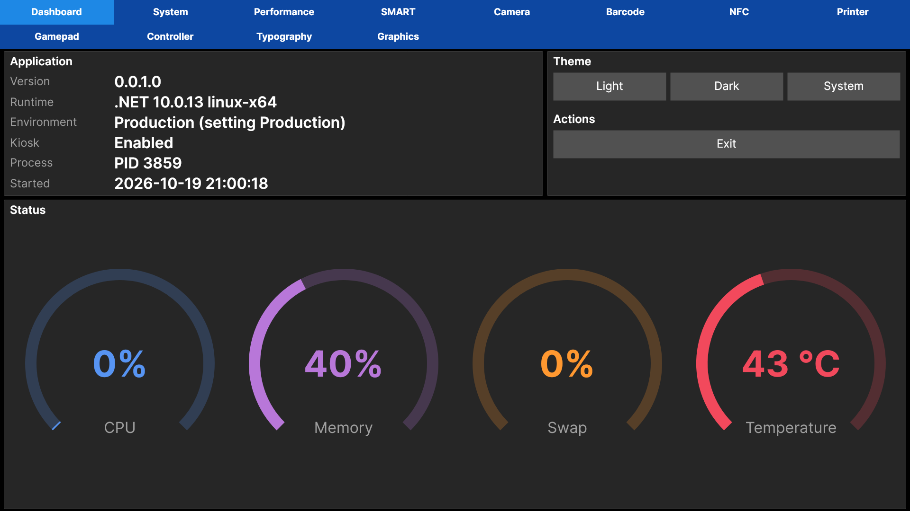

- App information (version, runtime, environment, kiosk, start time)
- Gauges for CPU, memory, swap, and temperature, theme switching, and exit

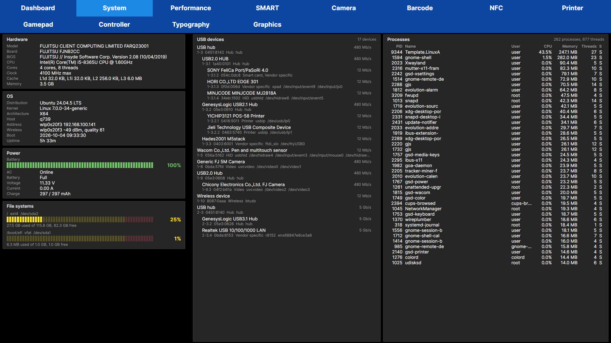

- Hardware, OS, power, and file system usage
- USB device connections (driver, device file), plugging and unplugging, and the process list

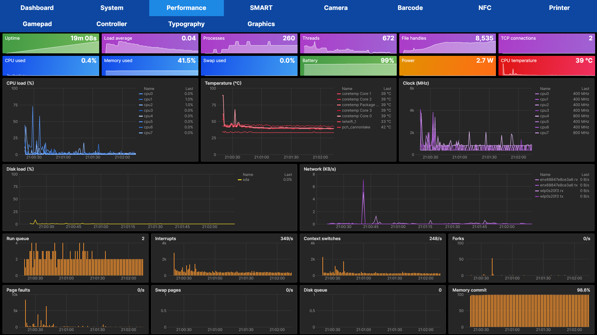

- Value panels for uptime, load, CPU, memory, power, and more with a 120-second trend
- Line charts of per-core usage and clock, temperature, disk, and network, and bar charts of kernel statistics

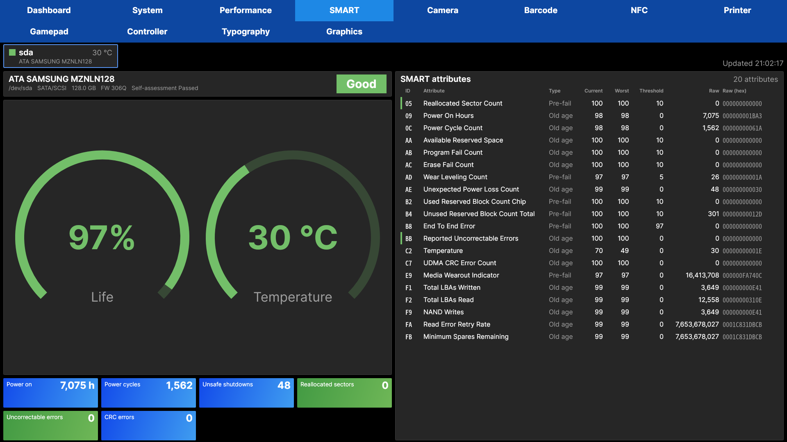

- SMART assessment, life, temperature, and key values of each disk
- List of the current, worst, threshold, and raw values of the attributes

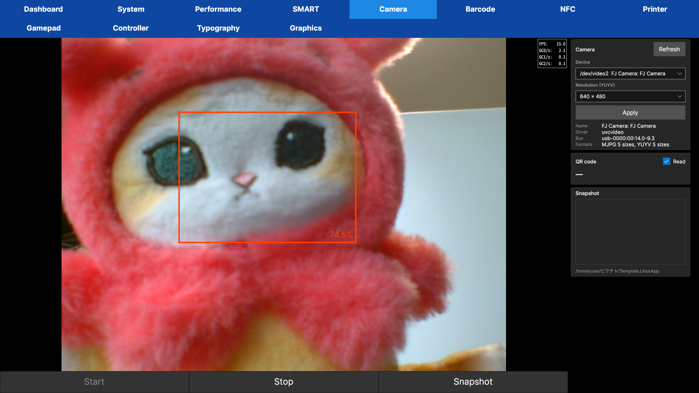

- Camera video, format and resolution switching, face detection, QR reading, and still images

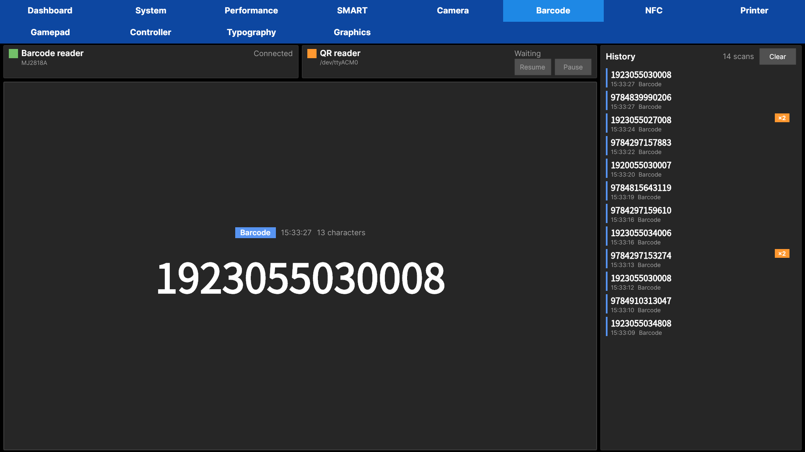

- Reading with barcode readers and QR readers, with the history and duplicate counts

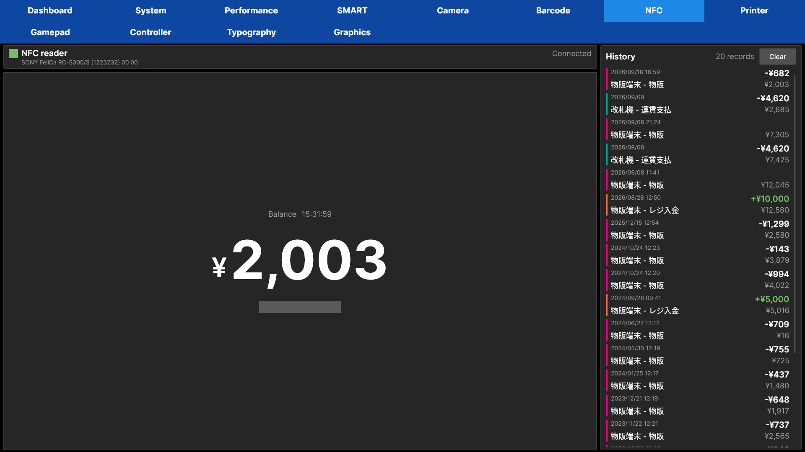

- Suica balance and usage history (PC/SC reader)

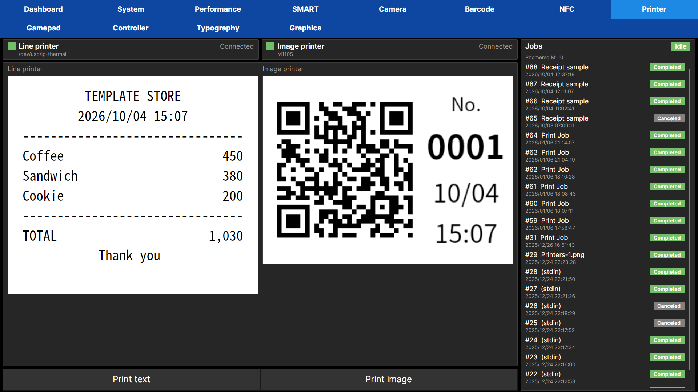

- Status and jobs of the line printer and CUPS printers
- Preview and printing of sample receipts and labels

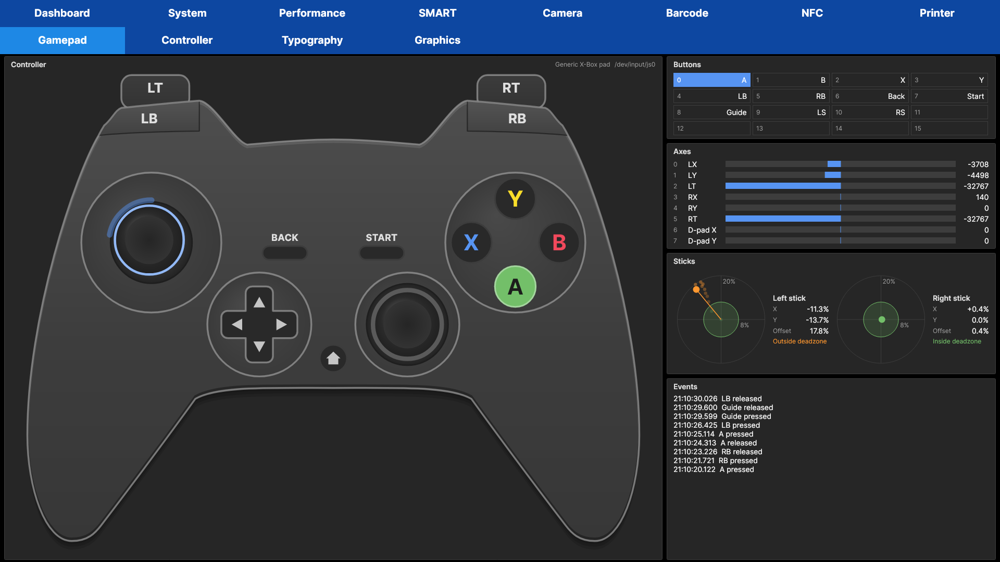

- Button, stick, and trigger presses on the pad
- Raw button and axis values, stick drift (an 8% dead zone circle and a magnified view), and recent input

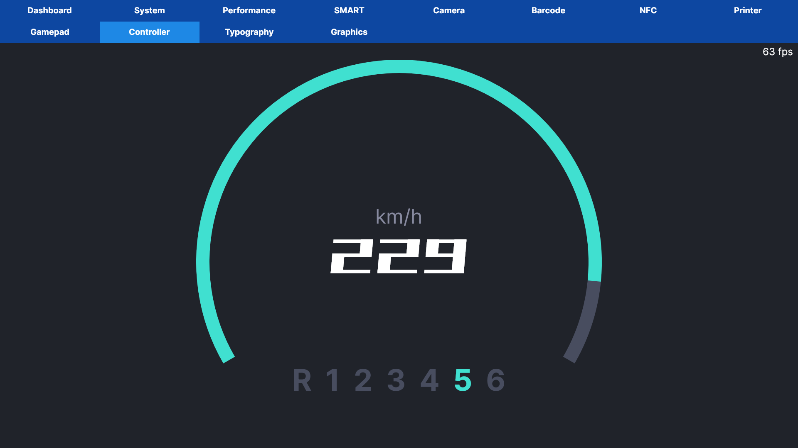

- Speedometer and gear operated with the pad, and sending to servos and LEDs

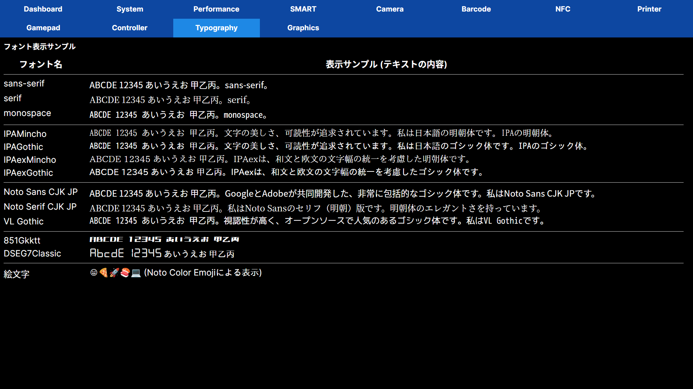

- Various fonts and emoji

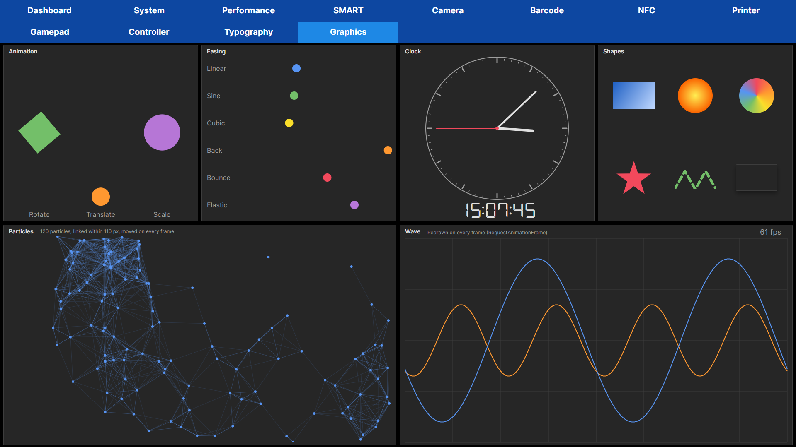

- Animation, easing, analog clock, shapes, particles, a waveform drawn every frame, and fps

## 🔑 SMART permissions

**Setup**

```bash
sudo usermod -aG disk <user>
sudo setcap cap_sys_rawio,cap_sys_admin+ep ~/Template.LinuxApp/Template.LinuxApp
```

## 🔗 Related Projects

| Project | Description |
| --- | --- |
| [template-wpf](https://github.com/usausa/template-wpf) | WPF desktop application template |
| [template-avalonia-desktop](https://github.com/usausa/template-avalonia-desktop) | Avalonia desktop application template |
| [template-avalonia-embedded](https://github.com/usausa/template-avalonia-embedded) | Avalonia application template for Raspberry Pi embedded devices |
